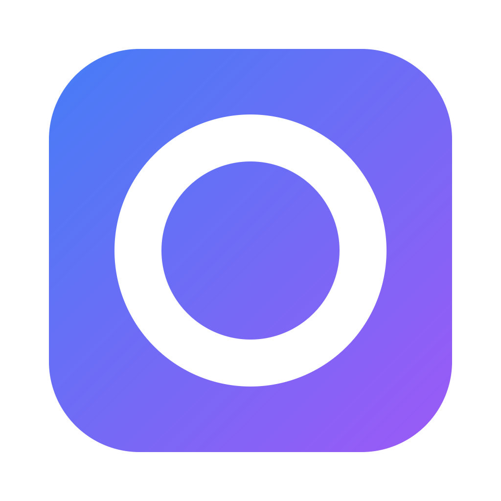

<div align="center">
  

  # Godrome

  *A lightweight native desktop music player for your own Navidrome / Subsonic library*

  [](https://github.com/XueJie1/godrome/actions/workflows/check.yml)
  [](https://go.dev)
  [](LICENSE)
  [](#platform-support)
  [](#archived)

  [Features](#features) • [Installation](#installation) • [Quick start](#quick-start) • [Usage](#usage) • [FAQ](#faq) • [Development](#development)

  **English** • [简体中文](README.md)
</div>

## Archived

> [!WARNING]
> **Godrome is archived and no longer maintained.**
>
> Use [MyGO Music](https://github.com/egoist/mygo-music) instead. It started as a third-party NetEase Cloud Music client; after a lawyer's letter it withdrew its built-in music service and became a provider-less player that keeps only the frontend, playback and plugin system, with music services supplied by community plugins.
>
> - **Navidrome / Subsonic**: install [mygo-music-subsonic](https://github.com/XueJie1/mygo-music-subsonic), a plugin written by this repository's author, to connect your library in MyGO Music.
> - **Want a Subsonic build that works out of the box**: try the third-party fork [cfour-hi/mygo-cloudmusic](https://github.com/cfour-hi/mygo-cloudmusic), which adds Subsonic / Navidrome support to an older MyGO Music.
>
> Everything below is kept for the record and is no longer updated.

Godrome is a desktop music player with a Chinese interface. It connects directly to your Navidrome (or any standard Subsonic/OpenSubsonic server), so you don't need a browser to play music.

> [!NOTE]
> A single-process native app: **Go + MyGO native UI + in-process libmpv**. No web UI, background service or database, and no mpv subprocess.

## Features

- **Library browsing** — album grid, album details, track search, 100 items per page
- **Play queue** — play a whole page, add to queue, previous/next, sequential / list repeat / single repeat
- **Format support** — MP3, FLAC, AAC, Opus, through the system's default audio output
- **Favorites** — favorite tracks, albums and artists; state is written back to the server
- **Appearance** — light, dark or follow the system; changeable accent color
- **Sound** — 10-band equalizer and presets
- **Offline browsing** — artwork and metadata are cached locally under a size cap, so browsing still works offline
- **System integration** — Linux desktop media controls can show the track and control playback (MPRIS)
- **Local files** — play local audio directly from the command line

Not supported: playlist editing (entry point only), lyrics, tray, shuffle, offline audio downloads.

## Installation

Requires **Go 1.27.1**, a **C compiler**, **GTK 3** and system **libmpv 2**.

| System | Install command |
| --- | --- |
| Arch Linux | `sudo pacman -S go gcc gtk3 mpv` |
| Debian / Ubuntu | Install Go 1.27.1, then `sudo apt install build-essential libgtk-3-0 libmpv2` (newer releases name the GTK package `libgtk-3-0t64`) |
| macOS | Install Go 1.27.1 and Xcode Command Line Tools, then `brew install mpv` |
| Windows | Install Go 1.27.1 and MinGW-w64 GCC, then put `mpv-2.dll` (or `libmpv-2.dll`) and its dependencies next to the exe |

### Platform support

| System | Status |
| --- | --- |
| Linux | Tested on real hardware, including audio output and MPRIS |
| Windows / macOS | Builds, and CI runs the tests; native desktop acceptance is not finished |

> [!WARNING]
> libmpv is provided by the system and is not bundled with the app. Without it you can still sign in and browse, but playback will not work; builds with `CGO_ENABLED=0` cannot play either.

## Quick start

```sh
make build
./build/godrome
```

To run straight from source, use `make run`.

Windows (PowerShell):

```powershell
$env:CGO_ENABLED = '1'
go build -buildvcs=false -trimpath -ldflags="-s -w -X github.com/egoist/mygo.production=1" -o build/godrome.exe .
```

The first launch shows a sign-in page:

| Field | Description |
| --- | --- |
| Server address | Full URL, e.g. `https://music.example.com`; with a path prefix behind a reverse proxy, use `https://example.com/navidrome` |
| Username / password | Your Subsonic account |

**Remember password** is checked by default. After a successful sign-in the password is stored in the OS keyring, and the next launch signs in automatically.

> [!NOTE]
> The password is kept only in the system keyring, never in the config file or logs. Sign out under **Settings → Account**; it stops playback and deletes the saved password.

## Usage

### Keyboard shortcuts

| Action | Key |
| --- | --- |
| Play / pause / resume | `Space` (when the window is focused) |
| Open selection / play | `Enter` |
| Move selection | Arrow keys |

When focus is on an input, button, switch or other control, `Space` goes to that control.

### Interface

- **Sidebar** — Library, Albums, Favorites, Playlists, Settings; collapses to an icon rail when the window is narrow.
- **Top search** — searches 300 ms after you stop typing, returning up to 100 tracks; clearing the search returns to the previous page.
- **Queue on the right** — collapses when the window is narrower than 860, and comes back automatically when it widens.
- **Settings** — Appearance, Sound, Account and Storage tabs; theme, equalizer and cache settings persist across launches.
- **Back / forward** — history buttons to the right of the title; going back restores the track that was selected before you left.

### Offline browsing

When the server is unreachable but content was cached before, pages still display and an "offline cache" icon appears in the top bar.

- **Settings → Storage** lets you turn offline fallback off, adjust the cache limit (128 MiB to 1 GiB) or clear the cache.
- Only albums and tracks you have browsed can be shown offline; **audio is not cached**, so uncached tracks cannot play offline.
- Authentication failures do not fall back to the cache; you stay on the sign-in page with the error.

### Playing local audio

```sh
./build/godrome song.mp3 album.flac
./build/godrome --autoplay song.flac
```

Put runtime options before the file paths.

## File locations

| Content | Location |
| --- | --- |
| Settings | `godrome/settings.json` under the system config directory (Linux: `~/.config/godrome/`) |
| Artwork and metadata cache | `godrome/cache` under the system cache directory (Linux: `~/.cache/godrome/cache`), 256 MiB cap by default |
| Password | Only in the system keyring, never in JSON |

## FAQ

**Missing libmpv on the first play?**

Install the system libmpv and restart the app. The app loads libmpv dynamically, so you don't need to build mpv yourself.

**Sign-in failed?**

- Make sure the address is a full URL including `http://` or `https://`
- Make sure the account can sign in through a browser or the official client
- If the server sits behind a reverse proxy, include the path prefix

**Can't open the library after going offline?**

Only albums and tracks you browsed before can be shown offline. Audio is not cached, so uncached tracks cannot play offline.

**Which servers are supported?**

Navidrome is the first-class target; standard Subsonic/OpenSubsonic APIs are also supported.

## Development

```sh
make check        # format check + go vet
make test         # unit tests and UI tests
make test-audio   # libmpv playback tests (needs ffmpeg to generate samples)
make test-mpris   # Linux MPRIS tests
```

- Code structure and each file's role: [README-dev.md](README-dev.md)
- Architecture rules and state ownership: [ARCHITECTURE.md](ARCHITECTURE.md)
- Repository conventions: [AGENTS.md](AGENTS.md)
- Behavior spec: [docs/spec.md](docs/spec.md)
- Scope: [docs/scope.md](docs/scope.md)
- Acceptance and measurements: [docs/acceptance.md](docs/acceptance.md), [docs/report.md](docs/report.md)
