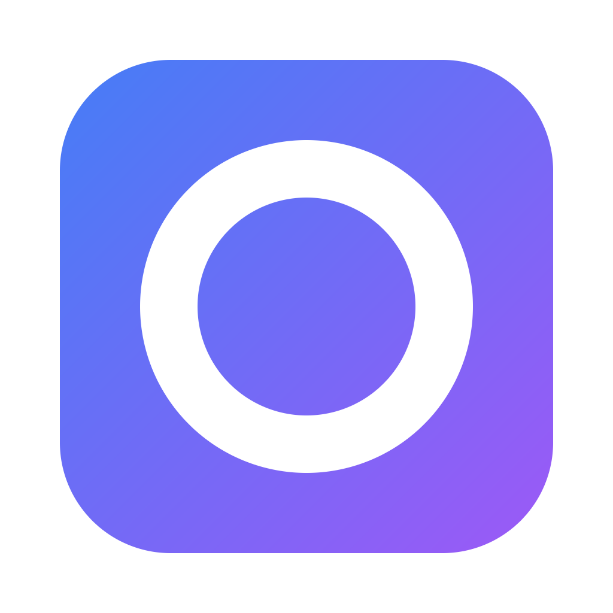

<div align="center">
  

  # Godrome

  *轻量的原生桌面音乐播放器，连接你自己的 Navidrome / Subsonic 曲库*

  [](https://github.com/XueJie1/godrome/actions/workflows/check.yml)
  [](https://go.dev)
  [](LICENSE)
  [](#系统支持)

  [功能](#功能) • [安装](#安装) • [快速开始](#快速开始) • [使用](#使用) • [常见问题](#常见问题) • [开发](#开发)
</div>

Godrome 是一个中文界面的桌面音乐播放器。它直接连接你的 Navidrome（或任何标准 Subsonic/OpenSubsonic 服务器），播放音乐时不需要浏览器。

> [!NOTE]
> 单进程原生应用：**Go + MyGO 原生 UI + 进程内 libmpv**。没有 Web UI、后台服务或数据库，也不启动 mpv 子进程。

## 功能

- **曲库浏览** — 专辑网格、专辑详情、歌曲搜索，每页 100 条
- **播放队列** — 播放整页、加入队列、上一首/下一首、顺序/列表循环/单曲循环
- **格式支持** — MP3、FLAC、AAC、Opus，使用系统默认音频输出
- **喜爱** — 标记歌曲、专辑和艺人，状态写入服务器
- **外观** — 浅色、深色或跟随系统，可换主题色
- **声音** — 十段均衡器和预设
- **离线浏览** — 封面和元数据有上限地缓存在本地，断网时仍可浏览
- **系统集成** — Linux 桌面媒体组件可查看曲目并控制播放（MPRIS）
- **本地文件** — 也可以直接从命令行播放本地音频

暂不支持：歌单编辑（只有入口）、歌词、托盘、随机播放、离线下载音频。

## 安装

需要 **Go 1.27.1**、**C 编译器**、**GTK 3** 和系统 **libmpv 2**。

| 系统 | 安装命令 |
| --- | --- |
| Arch Linux | `sudo pacman -S go gcc gtk3 mpv` |
| Debian / Ubuntu | 安装 Go 1.27.1，然后 `sudo apt install build-essential libgtk-3-0 libmpv2`（较新发行版 GTK 包名为 `libgtk-3-0t64`） |
| macOS | 安装 Go 1.27.1 和 Xcode Command Line Tools，然后 `brew install mpv` |
| Windows | 安装 Go 1.27.1 与 MinGW-w64 GCC，把 `mpv-2.dll`（或 `libmpv-2.dll`）及其依赖放到 exe 同目录 |

### 系统支持

| 系统 | 状态 |
| --- | --- |
| Linux | 已实机验证，包括音频输出与 MPRIS |
| Windows / macOS | 可以构建，CI 会运行测试；原生桌面验收尚未完成 |

> [!WARNING]
> libmpv 由系统提供，不随应用打包。缺少 libmpv 时仍能登录和浏览，但无法播放；`CGO_ENABLED=0` 的构建同样不能播放。

## 快速开始

```sh
make build
./build/godrome
```

想直接从源码运行，用 `make run`。

Windows（PowerShell）：

```powershell
$env:CGO_ENABLED = '1'
go build -buildvcs=false -trimpath -ldflags="-s -w -X github.com/egoist/mygo.production=1" -o build/godrome.exe .
```

首次启动会显示登录页：

| 项目 | 说明 |
| --- | --- |
| 服务器地址 | 完整 URL，例如 `https://music.example.com`；反向代理有路径前缀时写 `https://example.com/navidrome` |
| 用户名 / 密码 | 你的 Subsonic 账号 |

默认勾选 **记住密码**。登录成功后密码写入操作系统密钥环，下次启动自动登录。

> [!NOTE]
> 密码只保存在系统密钥环，不写入配置文件或日志。退出登录在 **设置 → 账号**，会停止播放并删除已保存的密码。

## 使用

### 快捷键

| 操作 | 按键 |
| --- | --- |
| 播放 / 暂停 / 继续 | `空格`（窗口聚焦时） |
| 打开选中项 / 播放 | `Enter` |
| 移动选择 | 方向键 |

焦点在输入框、按钮、开关等控件上时，空格留给该控件。

### 界面

- **侧栏** — 曲库、专辑、喜爱、歌单、设置；窗口变窄时收成图标栏。
- **顶部搜索** — 停止输入 300 ms 后搜索，最多返回 100 首；清空搜索回到原页面。
- **右侧队列** — 窗口窄于 860 时折叠，变宽后自动恢复。
- **设置** — 外观、声音、账号、存储四个标签，主题、均衡器和缓存设置下次启动保留。
- **后退 / 前进** — 标题右侧的历史按钮，返回时回到离开前选中的歌曲。

### 离线浏览

服务器连不上但之前缓存过内容时，页面照常显示，顶栏出现「离线缓存」图标。

- 在 **设置 → 存储** 可以关闭离线回退、调整缓存上限（128 MiB 到 1 GiB）或清除缓存。
- 只有浏览过的专辑和歌曲能离线显示；**音频不缓存**，离线时不能播放未缓存过的歌曲。
- 认证失败不会回退到缓存，会停在登录页提示错误。

### 播放本地音频

```sh
./build/godrome song.mp3 album.flac
./build/godrome --autoplay song.flac
```

运行选项要放在文件路径前面。

## 文件位置

| 内容 | 位置 |
| --- | --- |
| 设置 | 系统配置目录下的 `godrome/settings.json`（Linux：`~/.config/godrome/`） |
| 封面与元数据缓存 | 系统缓存目录下的 `godrome/cache`（Linux：`~/.cache/godrome/cache`），默认上限 256 MiB |
| 密码 | 仅保存在系统密钥环，不写入 JSON |

## 常见问题

**第一次播放提示缺少 libmpv？**

安装系统 libmpv 后重启应用。应用会动态加载 libmpv，不需要自己编译 mpv。

**登录失败？**

- 确认地址是完整 URL，包含 `http://` 或 `https://`
- 确认账号可以在浏览器或官方客户端登录
- 服务器在反向代理后面时，加上路径前缀

**断网后打不开曲库？**

只有之前浏览过的专辑和歌曲能离线显示。音频不缓存，离线时不能播放未缓存过的歌曲。

**支持哪些服务器？**

优先支持 Navidrome，同时兼容标准 Subsonic/OpenSubsonic 接口。

## 开发

```sh
make check        # 格式检查 + go vet
make test         # 单元测试与 UI 测试
make test-audio   # libmpv 播放测试（需要 ffmpeg 生成样本）
make test-mpris   # Linux MPRIS 测试
```

- 代码结构与各文件职责：[README-dev.md](README-dev.md)
- 架构规则与状态归属：[ARCHITECTURE.md](ARCHITECTURE.md)
- 仓库约定：[AGENTS.md](AGENTS.md)
- 行为规格：[docs/spec.md](docs/spec.md)
- 功能边界：[docs/scope.md](docs/scope.md)
- 验收与测量：[docs/acceptance.md](docs/acceptance.md)、[docs/report.md](docs/report.md)
