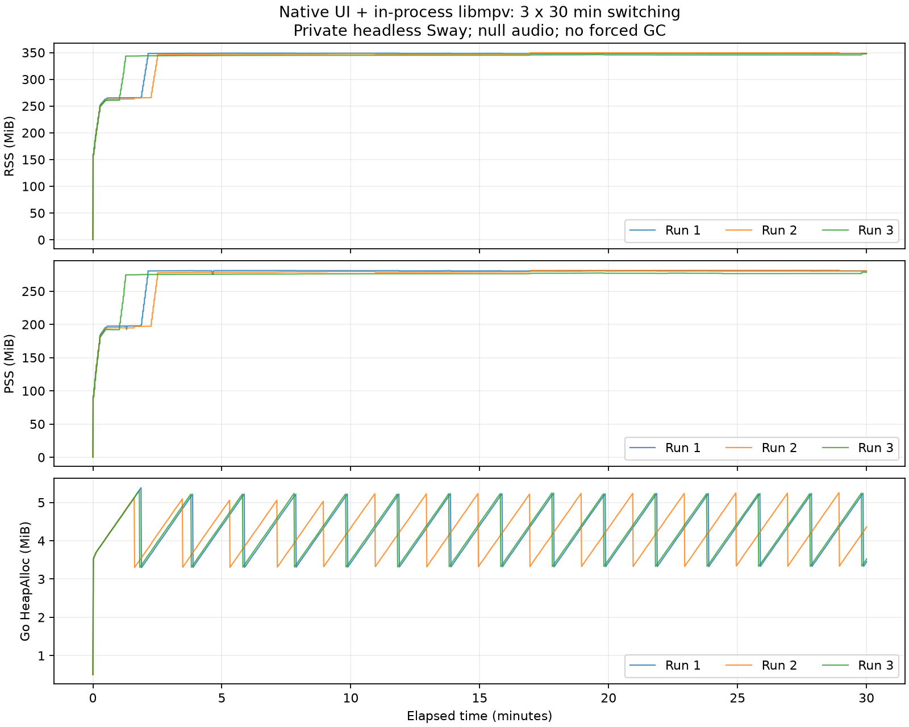
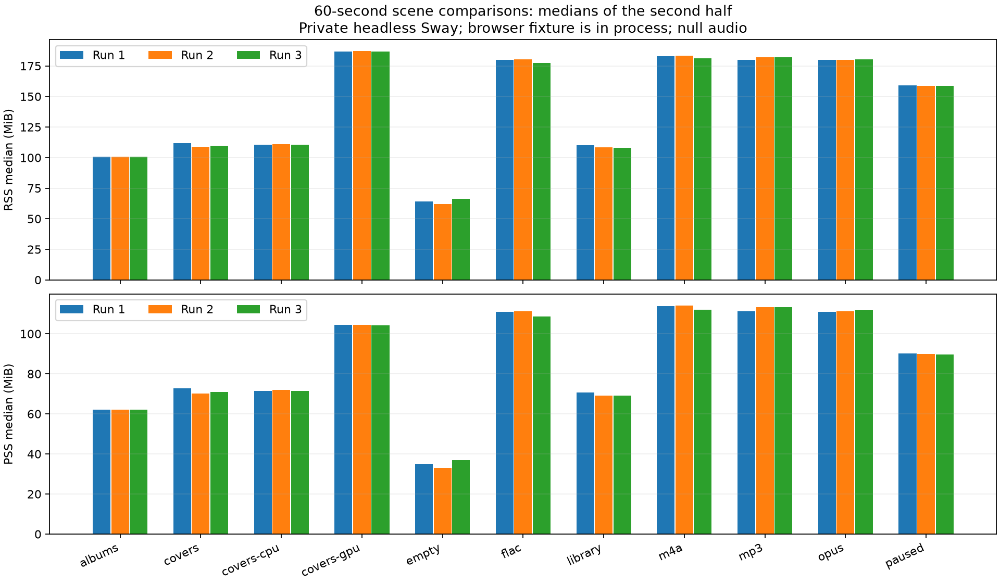

# 补充验收记录

日期：2026-10-07。沿用 [intent.md](intent.md) 的范围，Windows/macOS 暂无测试机或可执行 CI，按用户指示保留待验收。

2026-10-11：记住密码与自动登录由 UI tester 覆盖保存、再次启动、认证失败清除和退出登录删除。测试使用密钥环模拟，不写入本机密钥环，也不代替真实桌面钥匙串验收。

2026-10-11：设置页由 UI tester 覆盖主题色、深色外观、均衡器预设和频段调节。退出登录从侧栏移到设置页。无声输出确认均衡器滤镜可在播放中设置和清除，不证明听感。

2026-10-11：喜爱由模拟 Subsonic 覆盖 `star`、`unstar` 和 `getStarred2`。UI tester 验证歌曲标记、喜爱页读取，以及取消专辑和艺人喜欢。这不代替真实 Navidrome 上的喜欢往返。

2026-10-12：P1 由 UI tester 覆盖。窄于 860 的窗口折叠队列且不改保存的宽度，加宽后恢复；窄窗口音量先展开滑条再拖到 0。搜索、曲库、专辑页头分开，搜索不显示第一首的艺人。同一次搜索改字不增加历史，清空回到进入搜索前的页面，后退按歌曲 ID 滚回原行。喜爱页分歌曲、喜爱专辑、喜爱艺人，一万张专辑只构建可见卡片，停住后封面请求不再增加。均衡器十段在窄窗口仍可点到。这些是 UI tester，不代替真实桌面。

2026-10-18：侧栏五项加入图标。UI tester 覆盖窄于 140 时隐藏标题和文字、宽时同时显示，图标条目仍可点选页面；分隔条拖动覆盖新的 64 宽度下限。这是 UI tester，不代替真实桌面。

2026-10-18：空格暂停/继续由 UI tester 覆盖播放、暂停和文本输入获得焦点三种情况。MPRIS 在私有 `dbus-run-session` 上验证属性、方法、`PropertiesChanged` 信号和进度外推；完整应用又在私有 headless Sway + 私有会话总线上确认 `playerctl` 能发现 `godrome`，本地样本的曲名、艺人、时长和前进中的 `Position` 正确，`Seek`、`Pause`、`Play` 生效，`Quit` 正常关闭应用。没有在 GNOME/KDE 的实际媒体组件中操作，也没有用带封面的服务器曲目验证 `file://` 封面显示；这两项留给真实桌面验收。本次新增的会话总线连接和封面缓存文件不在 2026-10-07 的内存矩阵中，旧数据不能代表加入 MPRIS 后的占用。

## 功能与输入

| 方法 | 本次验证 | 边界 |
| --- | --- | --- |
| 构建、vet、race | Linux release 构建与业务/UI 测试；增加全键盘登录、专辑、歌曲、队列、暂停、进度和退出登录测试 | UI tester，不代替真实桌面输入；[检查日志](evidence/checks-20261007.txt) |
| libmpv 无声输出 | MP3、FLAC、AAC/M4A、Opus；暂停恢复、seek、EOF、HTTP 流、快速替换、错误和退出 | `ao=null`，不证明听感 |
| 临时 Navidrome | 固定 0.64.2，校验既有 SHA-256；一次性账号/曲库，登录至原始流播放闭环重新通过 | loopback；测试结束清理实例；无声输出 |
| 用户测试服务器 | 只读登录、专辑、搜索、原始流、暂停恢复、seek、停止重新通过 | 凭据仅经无回显输入进入进程环境/内存；无声输出，不保存内容 |
| Linux 真实窗口输入 | Sway 桌面上用 Wayland 键盘事件和 compositor 鼠标事件验证选曲、Enter 播放、暂停恢复、拖动与曲尾自动下一曲；关闭窗口正常退出 | 使用真实窗口和输入通路；属于自动化输入，不宣称人工操作全流程 |
| 用户主观听感 | 真实服务器歌曲可听到，音量合适，无杂音 | 用户在本会话确认；最初测试音未听到，不能把输出信号等同于听感通过 |
| 跨平台编译 | Windows amd64、macOS arm64 无 cgo UI 编译重新通过 | 无播放能力；原生 cgo 构建/自动测试/桌面输出未执行 |

真实桌面匿名状态证据见 [live-desktop.json](evidence/live-desktop.json)：包含状态、播放代次、曲目数量和进度，不保存服务器凭据、认证地址或歌曲标题。默认系统输出为耳机，系统音量未改动；用户后续要求测试应用音量为 50%。验收工具对音量设置硬性封顶 50%，不修改正式客户端默认设置。

## 验收期间发现并修复

libmpv 默认会将带认证参数的播放地址作为音频流媒体标题。适配层现设置固定 `force-media-title=Godrome` 与 `audio-client-name=Godrome`；实际系统音频流确认标题不含认证 URL。四格式播放器与基本检查在修复后通过。

## 内存测量方法

为遵守用户“期间要做其他事，尽量不控制电脑”的要求，完整测量在 **独立 headless Sway** 中运行，不向用户桌面发送输入，不抢焦点，不操作系统音量。使用真实 MyGO/GTK 原生窗口、原有应用视图/API/队列和进程内 libmpv；它不是 `ui.NewTester`，也不是真实显示器上的手动验收。

- 私有 compositor 只有 HEADLESS 输出，固定 1920×1080、125% 缩放，窗口 1080×720 逻辑尺寸；与真实桌面证据分开报告。
- release 编译选项与正式构建一致；独立驱动编译自 `app.go`、`metrics.go`、`acceptance_main.go`，未加入正式应用。空窗口使用正式二进制。
- 曲库为按需生成的 loopback Subsonic fixture，10,000 个专辑标识、专辑内 10,000 首歌曲；fixture 服务在被测进程内，因此浏览场景包含其分配成本。
- 四格式均使用 20 秒自生成样本。正常 EOF 后重播；暂停场景保留暂停状态。连续切歌每两秒替换一次，轮转四格式，队列长度为四。
- 每个场景三次，独立进程、顺序运行。连续切歌每次 1,800 秒；其他场景每次 60 秒。前者总计 90 分钟，不能用短测替代。
- 音频输出全程 `null`。进程 RSS/PSS/CPU/线程每 0.5 秒采样，Go 堆/goroutine 每秒采样，不主动 GC。CPU 百分比按一个核心计；采样峰值可能遗漏短于 0.5 秒的尖峰。记录动态库首次出现的采样时点与 RSS/PSS，但不据此声称逐库精确归因。
- “稳定窗口”仅指每次测量后半段的中位数。30 分钟场景另比较第 5–10 分钟与第 25–30 分钟的中位数。用户同时使用机器，CPU 和 PSS 不是独占环境的性能基准。
- 默认渲染沿用 MyGO 策略；另外以 `MYGO_GPU=0`、`MYGO_GPU=1` 测同一封面滚动场景，分别作为 CPU 和强制 OpenGL 诊断。强制 OpenGL 不等同于确认硬件 GPU，应结合所加载的驱动库解释。

复现（不操作当前桌面）：

```sh
make build check test acceptance-build test-audio
GODROME_SAMPLE_DURATION=20 sh scripts/audio-samples.sh testdata/acceptance-audio
python3 scripts/headless-acceptance.py --output docs/evidence/acceptance-new
```

原始数据保存在 [本次测量目录](evidence/acceptance-headless-20261007)，方法、二进制哈希及显示参数见 [method.json](evidence/acceptance-headless-20261007/method.json)。试跑数据单列于 `headless-pilot`、`acceptance-pilot`，均不能视作长期验收。

汇总校验与样本哈希见 [validation.json](evidence/acceptance-headless-20261007/validation.json)。测量后核对环境为 Go 1.27.1-X:nodwarf5、Sway 1.12、GTK 3.24.52、libmpv client 2.5.0；所有验收进程与私有 compositor 已退出。

## 结果与剩余项

三轮连续切歌已完成，各轮运行约 30 分钟，实际播放 900 次、错误数为零、正常退出。下表内存单位均为 MiB；差值为第 25–30 分钟减第 5–10 分钟的中位数。

| 轮次 | 后半段 RSS / PSS | RSS / PSS 峰值 | RSS 差值 | PSS 差值 | Go 堆差值 | 线程差值 / goroutine 差值 |
| --- | --- | --- | --- | --- | --- | --- |
| 1 | 348.26 / 280.48 | 348.90 / 281.13 | −0.51 | −0.54 | +0.009 | +1 / 0 |
| 2 | 349.46 / 281.27 | 349.63 / 281.47 | +2.14 | +2.37 | +0.046 | +1 / 0 |
| 3 | 345.55 / 276.81 | 347.52 / 278.51 | +0.81 | +0.71 | +0.004 | 0 / 0 |

三轮后半段 CPU 中位数均为单核的 1.97%，goroutine 均为 14，线程为 35 / 36 / 35；Go 堆中位数为 4.33 / 4.24 / 4.32 MiB，峰值为 5.38 / 5.25 / 5.31 MiB。本次 30 分钟工作负载在启动增长后趋于平台，未观察到持续累积；这不证明更长时间或其他工作负载下没有泄漏，也不将小幅正差值记为零。

完整矩阵已完成：12 个场景各三次，共 36 次、约 123 分钟；所有进程正常退出。重新汇总校验了时长、播放/暂停计数、一万首歌曲、封面请求与分页上限；被测二进制 SHA-256 与开始时一致，stderr 均为空。

以下为每次 60 秒场景后半段的中位数，三次数据依次列出；内存单位 MiB，CPU 单位单核百分比。它们是短时对照，不能单独证明长期稳定性。

| 场景 | RSS | PSS | Go 堆 | CPU % | 线程 | goroutine |
| --- | --- | --- | --- | --- | --- | --- |
| 空窗口 | 64.19 / 62.20 / 66.16 | 34.99 / 32.96 / 36.97 | 3.62 / 3.62 / 3.62 | 0.00 / 0.00 / 0.00 | 23 / 23 / 23 | 14 / 14 / 14 |
| 专辑分页 | 100.87 / 100.99 / 100.91 | 62.03 / 62.10 / 62.09 | 8.47 / 8.65 / 8.47 | 1.98 / 1.98 / 1.98 | 25 / 26 / 25 | 20 / 20 / 20 |
| 一万首歌曲/搜索/切页 | 109.99 / 108.43 / 108.23 | 70.67 / 69.23 / 69.08 | 12.75 / 12.51 / 10.54 | 1.98 / 1.98 / 1.98 | 28 / 26 / 28 | 23 / 23 / 23 |
| 滚动封面（默认） | 111.77 / 108.96 / 109.78 | 72.85 / 70.20 / 70.96 | 13.84 / 12.98 / 13.73 | 5.96 / 5.94 / 5.94 | 28 / 28 / 28 | 23 / 23 / 23 |
| MP3 | 180.06 / 182.10 / 182.16 | 111.22 / 113.19 / 113.20 | 3.98 / 3.98 / 3.97 | 3.90 / 3.90 / 3.90 | 33 / 33 / 33 | 14 / 14 / 14 |
| FLAC | 179.77 / 180.20 / 177.32 | 111.04 / 111.25 / 108.72 | 3.99 / 3.98 / 3.98 | 1.97 / 3.90 / 3.90 | 33 / 33 / 33 | 14 / 14 / 14 |
| AAC/M4A | 182.91 / 183.31 / 181.15 | 113.87 / 114.13 / 111.92 | 3.98 / 3.98 / 3.98 | 3.90 / 3.89 / 3.89 | 33 / 33 / 33 | 14 / 14 / 14 |
| Opus | 179.91 / 180.14 / 180.57 | 111.03 / 111.34 / 111.69 | 3.98 / 3.99 / 3.99 | 3.91 / 3.90 / 3.91 | 32 / 33 / 33 | 14 / 14 / 14 |
| 暂停 | 158.94 / 158.86 / 158.52 | 90.06 / 89.79 / 89.68 | 3.59 / 3.61 / 3.60 | 1.95 / 0.00 / 1.95 | 32 / 36 / 32 | 14 / 14 / 14 |
| 封面 MYGO_GPU=0 | 110.49 / 110.88 / 110.43 | 71.56 / 72.05 / 71.39 | 13.26 / 13.31 / 12.87 | 7.88 / 7.88 / 7.89 | 28 / 28 / 28 | 23 / 23 / 23 |
| 封面 MYGO_GPU=1 | 186.92 / 187.05 / 186.91 | 104.48 / 104.55 / 104.27 | 13.80 / 13.48 / 13.67 | 5.91 / 5.92 / 5.89 | 30 / 31 / 32 | 16 / 16 / 16 |

| 场景 | RSS 峰值 | PSS 峰值 | Go 堆峰值 |
| --- | --- | --- | --- |
| 空窗口 | 78.07 / 76.12 / 80.03 | 49.06 / 47.07 / 51.03 | 3.80 / 3.80 / 3.79 |
| 专辑分页 | 100.91 / 101.04 / 100.93 | 62.07 / 62.15 / 62.11 | 10.29 / 10.48 / 10.31 |
| 一万首歌曲/搜索/切页 | 110.99 / 109.45 / 111.37 | 71.67 / 70.25 / 72.23 | 15.72 / 16.21 / 17.23 |
| 滚动封面（默认） | 114.42 / 112.69 / 112.12 | 75.50 / 73.88 / 73.31 | 19.92 / 19.59 / 20.04 |
| MP3 | 180.07 / 182.10 / 182.22 | 111.23 / 113.20 / 113.26 | 4.14 / 4.14 / 4.13 |
| FLAC | 179.79 / 180.20 / 177.33 | 111.05 / 111.25 / 108.72 | 4.14 / 4.13 / 4.14 |
| AAC/M4A | 182.95 / 183.32 / 181.18 | 113.90 / 114.14 / 111.94 | 4.14 / 4.14 / 4.14 |
| Opus | 179.92 / 180.16 / 180.57 | 111.04 / 111.36 / 111.69 | 4.14 / 4.15 / 4.15 |
| 暂停 | 158.95 / 158.92 / 158.54 | 90.06 / 89.85 / 89.69 | 3.66 / 3.69 / 3.67 |
| 封面 MYGO_GPU=0 | 113.31 / 113.91 / 113.21 | 74.38 / 75.08 / 74.16 | 20.06 / 19.71 / 20.41 |
| 封面 MYGO_GPU=1 | 189.14 / 190.67 / 191.39 | 106.71 / 108.17 / 108.76 | 17.12 / 20.28 / 20.71 |

CPU、线程和 goroutine 的峰值、逐轮时长及状态计数完整保留在 [summary.json](evidence/acceptance-headless-20261007/summary.json)。封面三种渲染模式每轮均请求 1,000 张封面、缓存最多五页；大曲库每轮实际达到 10,000 首歌曲；每格式每轮实际播放三次；暂停场景结束时均保持暂停，所有场景错误数为零。



连续切歌第 60 秒 RSS 为 265.3 / 262.9 / 260.9 MiB，随后仍增长，到约第 2–3 分钟达到 345–349 MiB 的平台。Go 堆呈自然 GC 的锯齿，进程 RSS 没有跟着回落。本次未做原生分配追踪，不能确定这部分增长属于 libmpv、解码器或分配器缓存；后续若要压低切歌成本，应优先检查这些原生分配，保留同条件曲线比较。



默认与 CPU 模式封面 RSS 中位数约 110 MiB，强制 OpenGL 约 187 MiB；Go 堆都约 13 MiB。由此推断增量主要在 Go HeapAlloc 之外。OpenGL 模式 PSS 增量约 33 MiB，明显小于 RSS 增量；共享动态库是可能因素，当前没有逐库 PSS 归因。默认模式 CPU 占用中位数约 5.9%，显式 CPU 约 7.9%，强制 OpenGL 约 5.9%；机器同时用于其他任务，不能据此作精确性能优劣判断。

动态库加载时点见各轮 `run-*.libraries.json`。第一轮启动采样从不足 1 MiB 到约 0.5 秒时：默认/CPU 封面 RSS 为 98.64 / 98.62 MiB、PSS 为 59.90 / 59.87 MiB；OpenGL 为 RSS 174.40、PSS 92.15 MiB。该窗口同时包含应用和 GTK 初始化，不能视作单独驱动开销。默认/CPU 只出现 Wayland EGL 辅助库，OpenGL 额外出现 Mesa EGL/GLX、Gallium、LLVM 及 NVIDIA EGL/core 相关库；这包含驱动探测，不等同于确认实际渲染设备。首次播放也在约 0.5 秒加载 libmpv 及其依赖，仍不能将同一采样内全部增量精确分配给某个库。

下一阶段以约 110 MiB 浏览、180 MiB 短时无声播放、350 MiB 高频切歌作为本机 headless 观测基线，分别跟踪原生与 Go 堆增长；先做分配归因再制定预算。不得把这些值当作所有平台、显示环境和真实音频输出的硬性上限。

剩余项：Linux 由用户以物理键盘/鼠标完成全流程人工操作，待用户方便时确认；Windows/macOS 原生 cgo 构建、可执行自动测试、真实桌面播放和内存数据，因暂无测试机/已授权 CI 按用户指示保留待验收。当前不能宣称完整原型或三端运行兼容验收完成。
